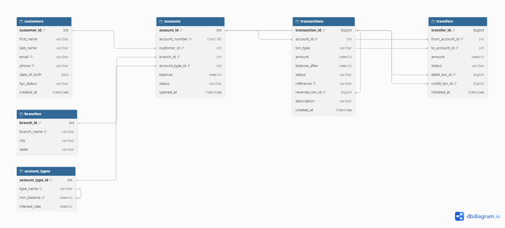
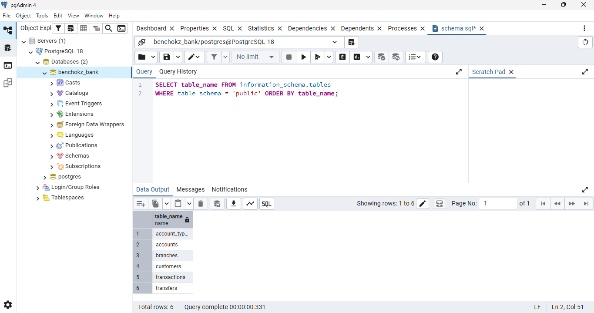
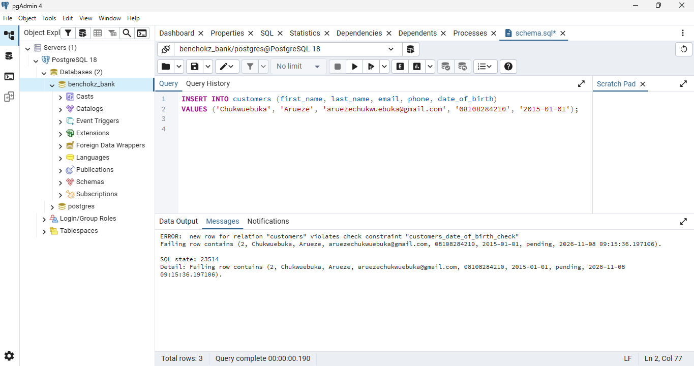
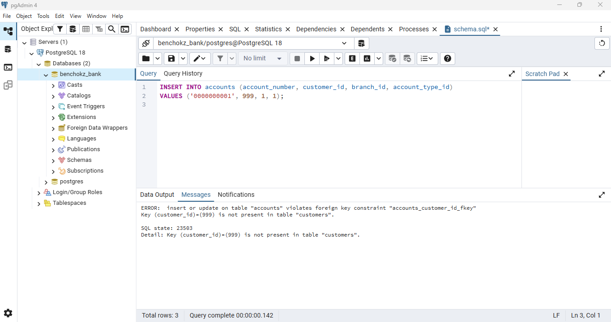

# Portfolio 1: Database Design and Modelling

**Evidence provided:** Chosen case study description, ER diagram, relational schema, keys, constraints, and normalisation explanation.

**Case study:** Benchokz Bank Limited (a simulated retail bank). See the root README for the full case study statement.

## In one minute
- A **relational database** stores data in tables that are linked to each other by keys.
- I designed **6 tables** for the bank: `customers`, `branches`, `account_types`, `accounts`, `transactions` and `transfers`, and drew them as an ER diagram.
- I wrote the schema in PostgreSQL with **primary keys, foreign keys, UNIQUE and CHECK rules**, so the database itself refuses bad data.
- I explained how the design reaches **third normal form (3NF)**, and which values I kept on purpose even though they could be calculated.
- I tested it: a valid record is accepted, and records that break a rule are rejected.

## Files in this folder
- `er_diagram.dbml` - source code of the ER diagram (rendered on dbdiagram.io)
- `er_diagram.png` - the rendered ER diagram
- `schema.sql` - PostgreSQL table definitions with keys and constraints
- `screenshots/` - evidence that the schema runs and its rules work

## ER diagram

The database has six tables. `customers` own `accounts`; each account belongs to one `branch` and one `account_type`. Every movement of money is a row in `transactions`, and `transfers` links the debit and credit transactions of a transfer between two accounts. `transactions.reverses_txn_id` points back to another transaction so a reversal can be traced to the original.

## How I ran it
I installed PostgreSQL 18 with pgAdmin 4 and created a database called `benchokz_bank`. I opened `schema.sql` in pgAdmin's Query Tool for that database and pressed F5. The `NOTICE: table does not exist, skipping` messages are expected on a first run, because the script begins with `DROP TABLE IF EXISTS`.

## Keys and constraints
- **Primary keys:** every table has a surrogate integer key (`customer_id`, `account_id`, `transaction_id`, and so on).
- **Foreign keys:** `accounts` references `customers`, `branches` and `account_types`; `transactions` references `accounts`; `transfers` references `accounts` (twice) and `transactions` (twice).
- **UNIQUE:** customer email and phone, account number, branch name, account type name, and transaction reference. These stop duplicate customers and duplicate postings.
- **CHECK:** `balance >= 0`, `amount > 0`, restricted values for `status`, `kyc_status` and `txn_type`, a minimum age for customers, and `from_account_id <> to_account_id` so an account cannot transfer to itself.
- **Self-reference:** `transactions.reverses_txn_id` links a reversal to the transaction it reverses.

## Normalisation

**Starting point.** If everything were kept in one table, a row might look like this:

| customer_name | email | branch_name | branch_city | account_number | account_type | interest_rate | transactions |
|---|---|---|---|---|---|---|---|
| Chukwuebuka Arueze | c@example.com | Onitsha Main | Onitsha | 0123456789 | savings | 3.50 | deposit 5000; withdrawal 1000 |

**First normal form (1NF).** The `transactions` cell holds two transactions in one value, so it is not atomic and cannot be summed, filtered or indexed properly. I fixed this by giving every transaction its own row, which is now the `transactions` table.

**Second normal form (2NF).** Once each transaction is a row, the key is the account plus the individual transaction. But the customer's name and email, and the branch, depend only on the account, not on the transaction. They would be repeated on every transaction row, and a customer with 1,000 transactions would have their details stored 1,000 times, with 1,000 rows to update if their email changed. I separated the data into `customers`, `accounts` and `transactions`, so each fact is stored once.

**Third normal form (3NF).** Some columns still depended on other non-key columns instead of on the key:
- `account_number → branch_name → branch_city`: the city is a property of the branch, not of the account, so branch data moved to `branches`.
- `account_number → account_type → interest_rate`: the rate is a property of the account type, so it moved to `account_types`.

After this, each column depends on the key, the whole key, and nothing but the key. The result is the six tables in the ER diagram, each with its own primary key.

**Deliberate trade-offs.** I kept three values that could in theory be derived, because the bank needs them to be fast and easy to read:
- `transactions.balance_after` could be calculated by replaying the history, but storing it makes statements and balance audits quick and shows the balance at that moment.
- `accounts.balance` is the sum of an account's transactions, but it is read constantly and is the row that will be locked during transfers in Portfolio 3.
- `transfers.amount` repeats the amount of the linked transactions, but gives a one-row summary of each transfer.

The risk with duplicated values is that they can disagree. I will handle this in Portfolio 3 by updating the balance and writing the transaction inside the same database transaction, so either both change or neither does.

## Testing and evidence
| Screenshot | What it shows |
|---|---|
| `01_tables_list.png` | All six tables exist in the `public` schema |
| `02_reference_data.png` | Reference data loaded into `account_types` |
| `03_valid_insert.png` | A valid customer is accepted (`INSERT 0 1`) |
| `04_check_constraint_error.png` | A customer born in 2015 is rejected by the `CHECK` constraint on date of birth |
| `05_foreign_key_error.png` | An account for non-existent customer 999 is rejected by the foreign key |

## What I learned
- Splitting data into separate tables means each fact is stored once, so it cannot disagree with itself.
- Keys and constraints let the database protect the data, instead of trusting every application to behave.
- Normalisation is a guide, not a law: I kept a few calculated values on purpose for speed, and I know the risk that comes with that.

## Reflection
I gained this understanding through the MIT 8103 course material and by building the Benchokz Bank database myself in PostgreSQL and pgAdmin. Running the schema and deliberately triggering the CHECK and foreign key errors showed me in practice how keys, constraints and normalisation protect data.

**AI use:** Claude (an AI assistant by Anthropic) helped me draft the schema, the ER diagram source, the normalisation write-up and this README, and helped me understand keys, constraints and normalisation. I ran the schema myself in PostgreSQL and pgAdmin, triggered the errors, took the screenshots, and checked that the results match what I describe.
