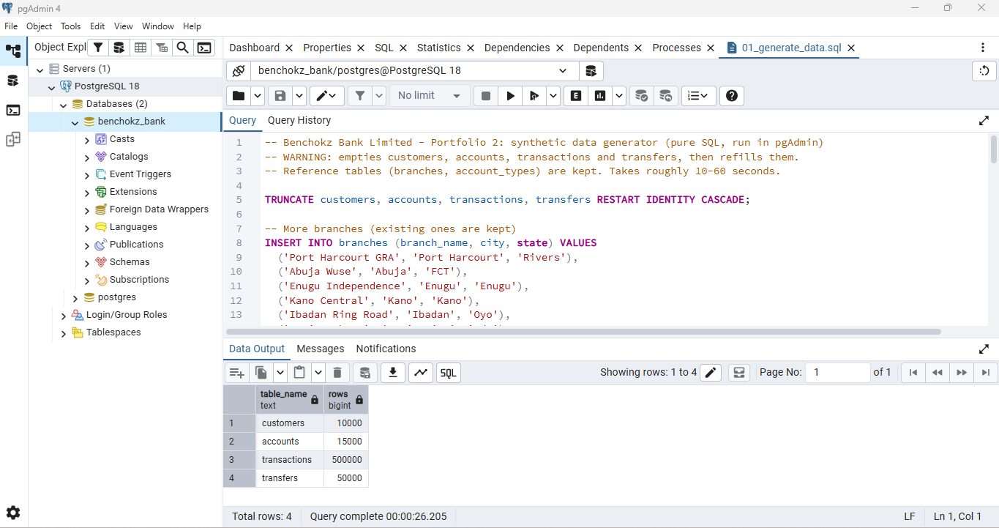
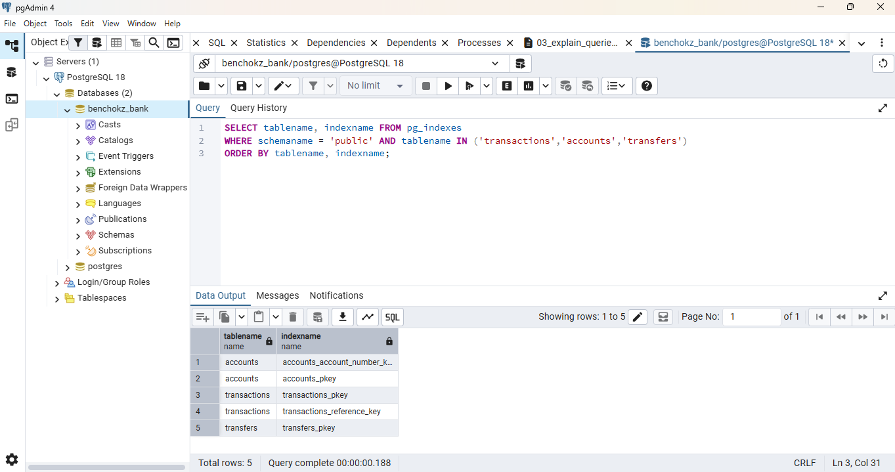
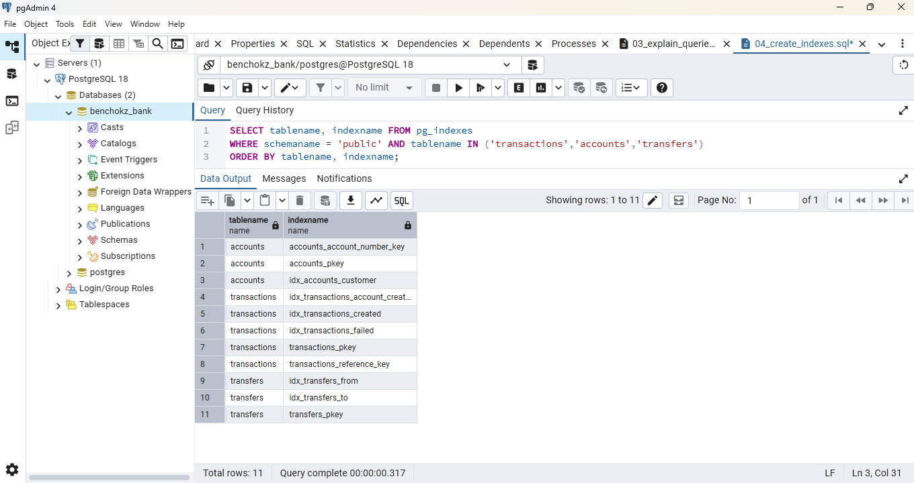
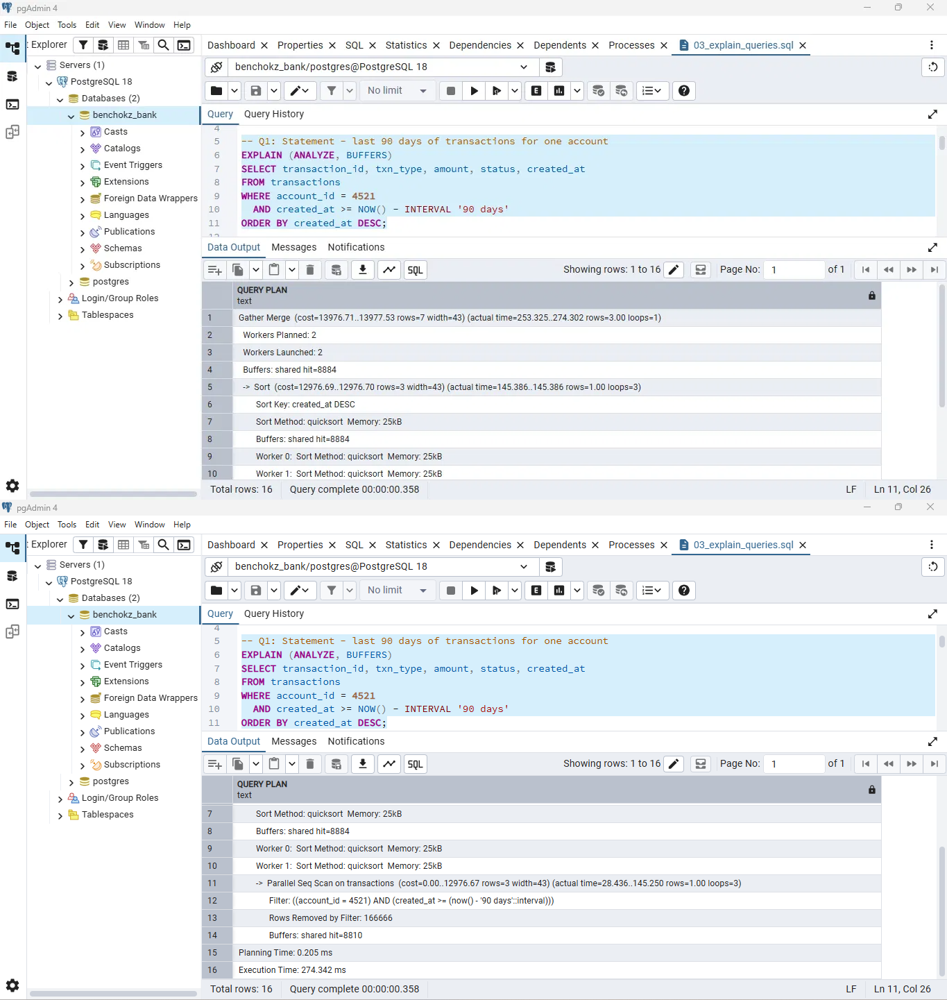
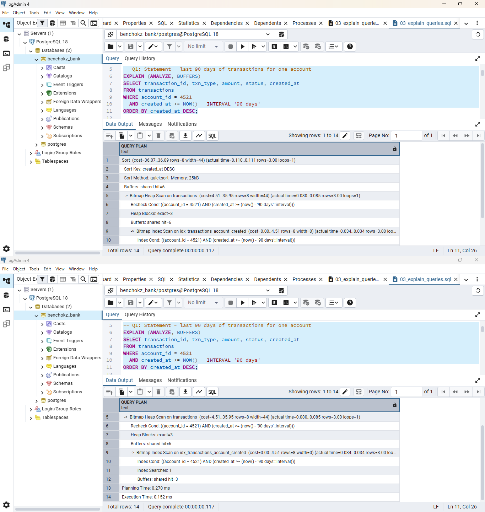

# Portfolio 2: Query Processing and Optimisation

**Evidence provided:** SQL queries, query results, execution plans, indexing/optimisation evidence, and brief performance analysis.

**Case study:** Benchokz Bank Limited (a simulated bank). I used the same `benchokz_bank` database from Portfolio 1.

## In one minute
- I filled the database with **a lot of fake data** (500,000 transactions).
- I ran 5 queries a bank would really use, and measured how long each took.
- I then added **indexes**, which work like the index at the back of a book. They help the database find rows without reading the whole table.
- I ran the same queries again. **Every query got faster.** The best one went from 274 ms to 0.15 ms.

## Files in this folder
| File | What it does |
|---|---|
| `01_generate_data.sql` | Creates the fake data |
| `02_queries.sql` | The 5 queries |
| `03_explain_queries.sql` | The same queries, but showing how the database runs them and how long they take |
| `04_create_indexes.sql` | Adds the indexes |
| `05_drop_indexes.sql` | Removes the indexes (used to repeat the "before" test) |
| `screenshots/` | My evidence: results, timings, and before/after plans |

## How the data was created
`01_generate_data.sql` fills the tables from Portfolio 1 with random data:

| Table | Rows |
|---|---|
| customers | 10,000 |
| accounts | 15,000 |
| transactions | 500,000 |
| transfers | 50,000 |

The data is fake (random names, amounts and dates). I needed a big table so that the speed difference would be easy to see.

## How I tested
1. Ran the 5 queries and saved the results.
2. Ran each query with `EXPLAIN ANALYZE`. This shows **how** the database ran it and **how long** it took. This was the **"before"** test (no indexes yet).
3. Ran `04_create_indexes.sql` to add 6 indexes.
4. Ran the same `EXPLAIN ANALYZE` again. This was the **"after"** test.

I ran every test **twice** and wrote down the second result. The first run is sometimes slower because the data has to be read from disk. By the second run it is already in memory, so the comparison is fair.

## The 5 queries
| # | What it finds |
|---|---|
| Q1 | The last 90 days of transactions for one account (a bank statement) |
| Q2 | The top 10 customers by transaction value in the last 30 days |
| Q3 | All accounts that belong to one customer |
| Q4 | How many transactions failed each day in the last 30 days (for auditors) |
| Q5 | All transfers sent from or received by one account |

## The indexes I added
| Index | Which query it helps | Why |
|---|---|---|
| `transactions (account_id, created_at)` | Q1 | Finds one account's transactions straight away, already in date order |
| `transactions (created_at)` | Q2 | Quickly picks out only the last 30 days |
| `accounts (customer_id)` | Q3 | PostgreSQL does not index foreign keys on its own, so I added one |
| `transactions (created_at)` only for failed rows | Q4 | A small index that covers just the failed transactions |
| `transfers (from_account_id)` and `transfers (to_account_id)` | Q5 | One index for the sender side and one for the receiver side |

Indexes before and after. At first there were 5 (the ones PostgreSQL creates automatically), and after my script there are 11:

## Results
**Seq Scan** means the database read the **whole table**, row by row. An **index scan** means it used an index to **jump straight** to the rows it needed.

| Query | Before: what happened | Before (ms) | After: what happened | After (ms) | How much faster |
|---|---|---|---|---|---|
| Q1 | Read all 500,000 transactions (Parallel Seq Scan) | 274.342 | Used the index (Bitmap Index Scan) | 0.152 | about 1,800 times |
| Q2 | Read the whole `transactions` table, then joined the tables | 613.151 | Used the date index, then joined the tables | 191.498 | about 3 times |
| Q3 | Read all 15,000 accounts (Seq Scan) | 4.108 | Used the index (Index Scan) | 0.091 | about 45 times |
| Q4 | Read all 500,000 transactions (Parallel Seq Scan) | 225.966 | Read only the small index (Index Only Scan) | 3.571 | about 63 times |
| Q5 | Read all 50,000 transfers (Seq Scan) | 22.735 | Used both indexes together (BitmapOr) | 0.230 | about 99 times |

Example with Q1. Before, then after:

All the other plans are in the `screenshots` folder. They are named by query, for example `03_q3_plan_before.png` and `04_q3_plan_after.png`.

## What the results mean
**Q1, Q3 and Q5 (finding a few rows in a big table).**
Before, the database read every row to find just a few. For Q1 it read all 500,000 transactions to return 3 rows. With an index it went straight to those 3 rows. For Q5 the condition has an `OR` (sender or receiver), so the database used one index for each side and combined the results.

**Q4 (a small index for failed transactions only).**
Only a small part of the transactions are failed ones, so this index is small. The query only needs the date from those rows, so the database could answer using the index alone. It never had to open the table (`Heap Fetches: 0`).

**Q2 (the one that improved least).**
Q2 was only about 3 times faster. The date index helped by cutting 500,000 transactions down to about 40,000. But the query still has to join those rows with the `accounts` and `customers` tables, and the join needs all the rows of those two tables, so an index cannot help there. Also, the 40,000 matching rows are spread over almost the whole table, so the database still read nearly every page. This shows that **indexes help most when you need only a few rows**.

**The cost of indexes.**
Indexes take up disk space. They also slow down inserts, updates and deletes a little, because every index has to be updated too. So you should only create indexes that your queries actually use.

**A limit of my test.**
My data is random and evenly spread. Real bank data is not, so real results could be different.

## What I learned
- An index helps most when a query needs only a **few rows** from a big table.
- The first run of a query can be slow because the data is read from disk, so before-and-after tests must be compared fairly.
- Indexes cost disk space and make writes a little slower, so each one should have a reason.

## Reflection
My first runs of some tests included disk reads, which made them look slower than they really were. I ran each test again until the data was in memory, so that the "before" and "after" results could be compared fairly. I also learned that an index does not fix every query, as the Q2 result showed.

**AI use:** Claude (an AI assistant by Anthropic) helped me generate the script that creates the fake data, the five queries, the `EXPLAIN` and index scripts, and a draft of this README, and it helped me understand how to read the execution plans. I ran every script myself in PostgreSQL and pgAdmin, took all the screenshots and recorded the timings from my own runs, and checked that the explanations match what my plans show.
