# Portfolio 4: NoSQL and Advanced Data Models

**Evidence provided:** NoSQL model based on the same case study, document example (MongoDB), implementation evidence, and explanation of suitability.

**Case study:** Benchokz Bank Limited (a simulated bank). Same customers, accounts and transactions as Portfolios 1 to 3, this time modelled as **documents** in MongoDB.

## In one minute
- A **document database** stores data as flexible, JSON-like documents instead of rows in tables.
- I modelled the bank in MongoDB with **2 collections**: `customers` (each customer's accounts are stored *inside* the customer document) and `transactions` (a log of every payment, with details that differ by channel).
- I loaded fake data (5,000 customers, 50,000 transactions), ran queries, built aggregation pipelines (MongoDB's version of `GROUP BY` and joins), and added indexes.
- My conclusion: MongoDB is a good fit for **customer profiles and transaction logs**, but I would keep **money movement** (transfers, balances) in PostgreSQL.

## Which type of NoSQL, and why
NoSQL has four main types: **document**, **key-value**, **column** and **graph**. I chose a **document** database (MongoDB) because a bank's activity data is naturally nested and varies from record to record:
- An ATM withdrawal records the ATM id and location. A POS payment records the merchant and terminal. A mobile-app transfer records the phone model and app version. In SQL, one `transactions` table would need many mostly-empty columns, or many extra tables. A document simply holds the fields that apply.
- A customer and their accounts are almost always read together, so storing them in one document means **one read instead of a join**.

## Files in this folder
| File | What it does |
|---|---|
| `01_load_data.js` | Creates the database and fills it with fake data |
| `02_queries.js` | Find, insert, update and delete examples |
| `03_aggregations.js` | Five aggregation pipelines (grouping, joining, unwinding arrays) |
| `04_indexes_explain.js` | The same queries before and after adding indexes, with execution statistics |
| `screenshots/` | My evidence for each step |

## How I ran it
I used **MongoDB Compass** (the graphical tool) connected to my local MongoDB server at `mongodb://localhost:27017`. I opened the built-in shell (`>_MONGOSH`) at the bottom of Compass, typed `use benchokz_nosql`, and pasted each script (01 to 04) into it in order. I used the Compass screens (Documents, Indexes) to look at the stored data and the indexes, and took screenshots of the shell output and of those screens.

## The data model
### Collection 1: `customers` (accounts embedded)
```json
{
  "customerId": 777,
  "firstName": "Chinedu", "lastName": "Okafor",
  "email": "customer777@example.com",
  "kycStatus": "pending",
  "address": { "city": "Ikeja", "state": "Lagos" },
  "accounts": [
    { "accountNumber": "0000007770", "type": "wallet", "branch": "Ikeja Central",
      "balance": 989901.93, "status": "frozen" }
  ],
  "preferences": { "language": "yo", "statementDelivery": "paper" }
}
```
Some customers also have `preferences` or `nextOfKin`, and others do not. No empty columns are needed.

### Collection 2: `transactions` (channel-specific details in `metadata`)
```json
{
  "txnRef": "NTX000000002",
  "customerId": 4814, "accountNumber": "0000048141",
  "type": "deposit", "amount": 313977.47, "currency": "NGN",
  "status": "completed", "channel": "pos",
  "createdAt": "2026-07-14T06:47:17Z",
  "metadata": { "merchant": { "name": "Jumia Food", "category": "Food" },
                "terminalId": "T82136", "cardLast4": "2396" }
}
```
A mobile-app transaction has `metadata.device` (OS, model, app version), an ATM one has `metadata.atmId`, and so on. Transfers also carry a `counterparty` object.

### Design decisions
| Decision | Why |
|---|---|
| **Embed** accounts inside `customers` | They are read together, and a customer has only a few accounts, so the document stays small |
| **Separate** `transactions` collection | There can be thousands per customer. Embedding them would make one document grow without limit (MongoDB documents have a 16 MB maximum) |
| Keep `customerId` in each transaction | The link between a transaction and its customer, like a foreign key. MongoDB does not enforce it |
| `metadata` object that differs by channel | Lets each channel store only the fields that make sense for it |

### The same data in SQL and in MongoDB
| | PostgreSQL (Portfolios 1 to 3) | MongoDB (this portfolio) |
|---|---|---|
| Structure | 6 tables, fixed columns | 2 collections, flexible documents |
| Customer with accounts | `customers` JOIN `accounts` | One document, one read |
| New channel with new fields | Change the table (`ALTER TABLE`) | Just insert the document |
| Rules (`CHECK`, foreign keys) | Enforced by the database | Not enforced, so the application must check |

## Queries (`02_queries.js`)
| # | What it shows |
|---|---|
| Q1 | A customer **and all their accounts in one read**, with no join |
| Q2 | Filtering on a field **inside nested data** (`metadata.device.os`) |
| Q3 | Filtering on a field that **only POS documents have** (`metadata.merchant.category`) |
| Q4 | Searching **inside an array** (customers with any frozen account) |
| Q5 | **Inserting** a transaction from a new channel (USSD) with different fields, with no schema change |
| Q6 | **Updating** one account inside the array (freeze it) and adding a note |
| Q7 | **Deleting** the demo document |

**Results (screenshots):**

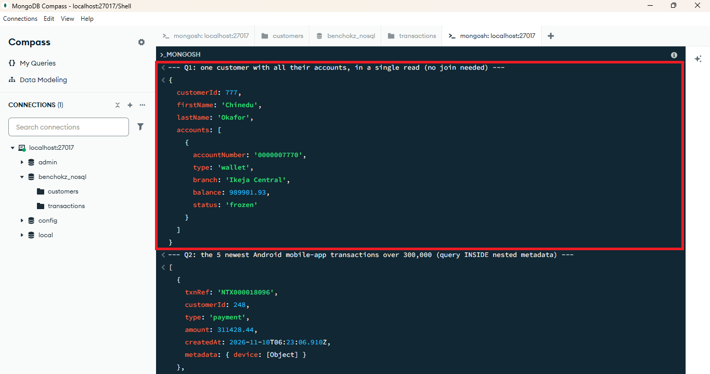
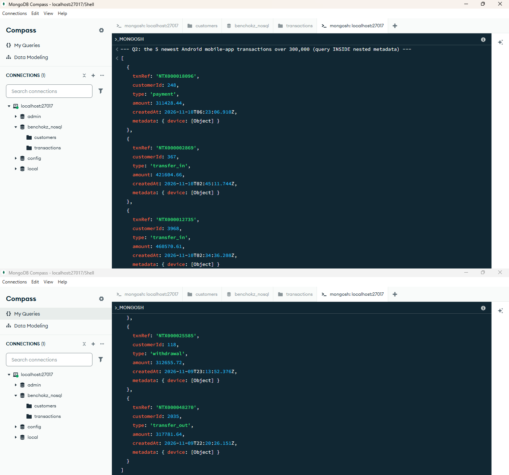
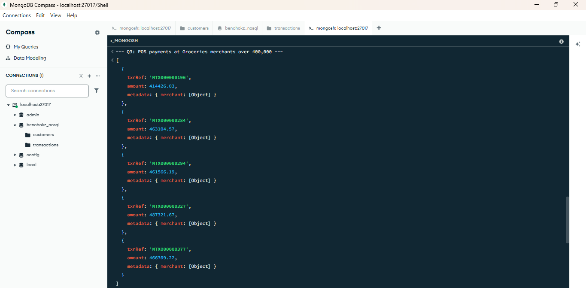
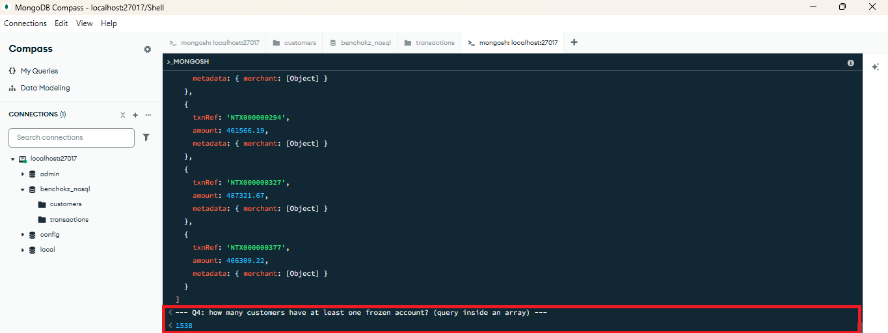
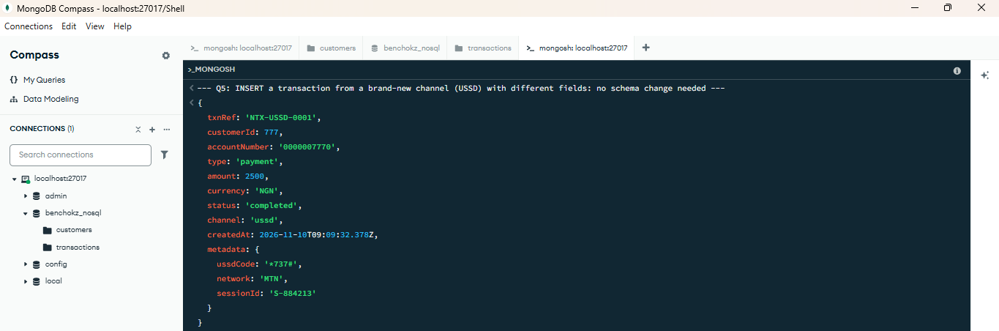
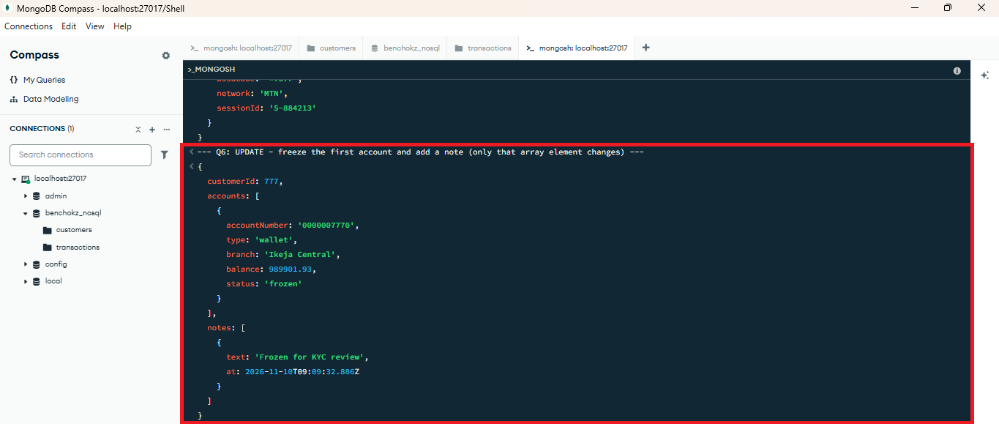
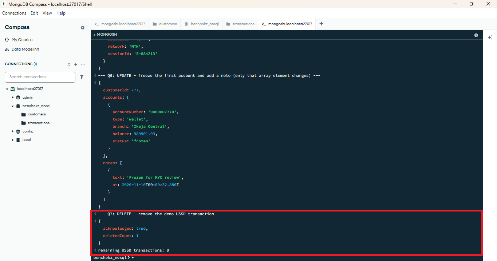

## Aggregation pipelines (`03_aggregations.js`)
An aggregation pipeline passes documents through stages, one after another (`$match` filters, `$group` groups, `$sort` orders, and so on).

| # | Question | Stages used | SQL equivalent |
|---|---|---|---|
| A1 | Number and value of completed transactions per channel | `$match`, `$group`, `$sort` | `GROUP BY channel` |
| A2 | Top 10 customers by value in the last 30 days, with names | `$match`, `$group`, `$sort`, `$limit`, `$lookup`, `$unwind` | `JOIN` + `GROUP BY` + `LIMIT` |
| A3 | Failed transactions per day (audit) | `$match`, `$group` with `$dateToString` | `GROUP BY date` |
| A4 | Total balance per city | `$unwind` (opens the embedded accounts array), `$group` | `JOIN` + `GROUP BY` |
| A5 | Spending per POS merchant category | `$match`, `$group` | `GROUP BY` on a nested field |

**Results (screenshots):**

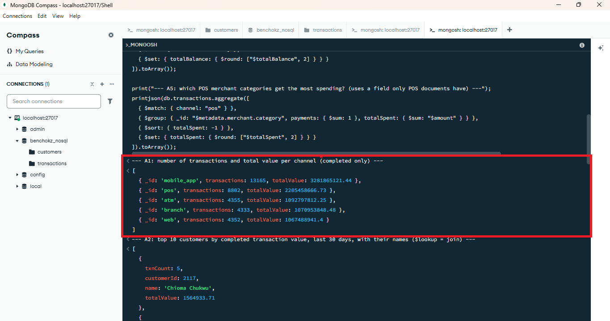
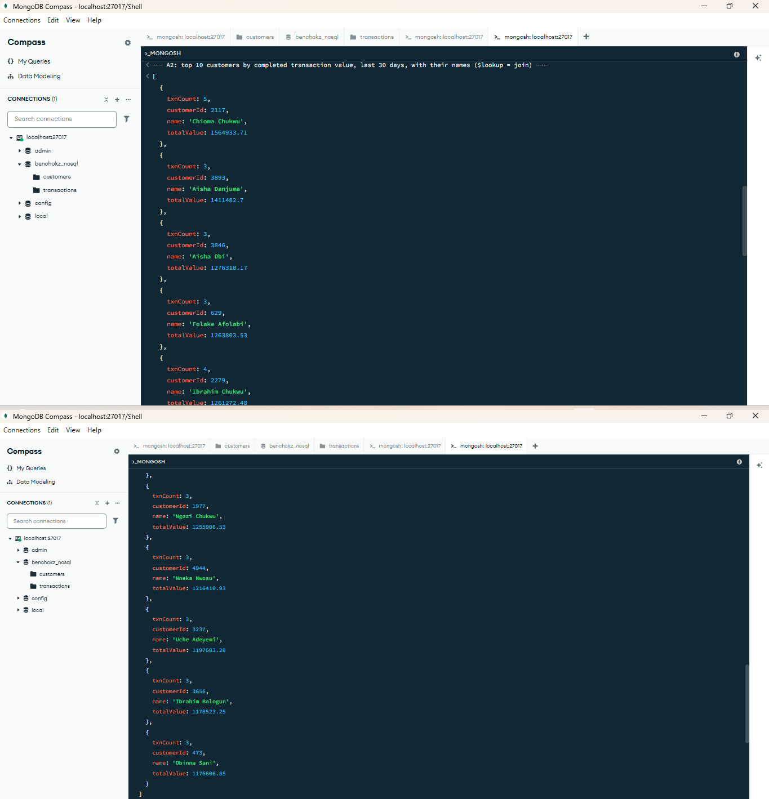
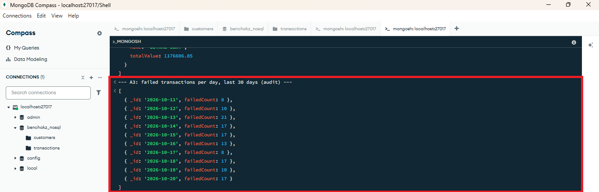
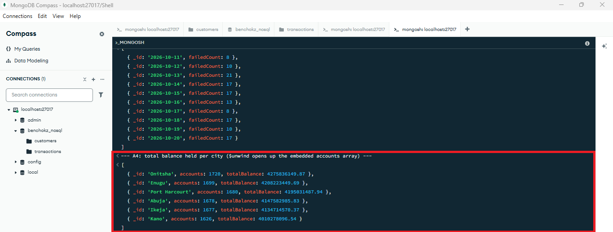
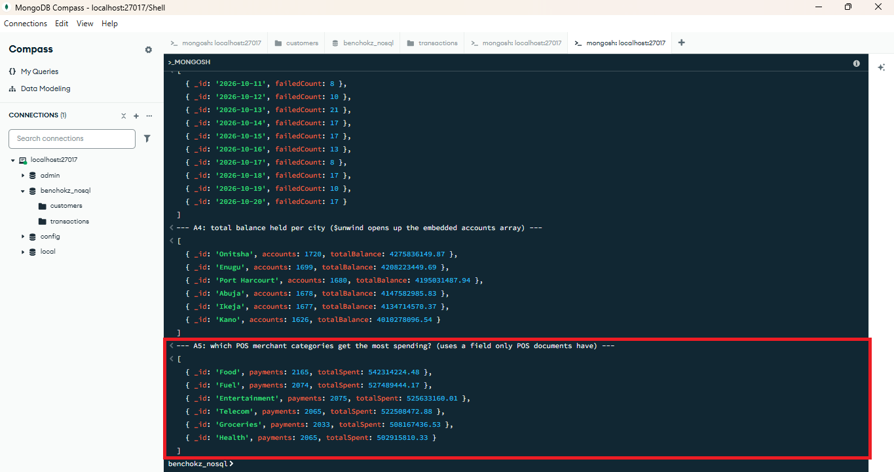

## Indexes and execution statistics (`04_indexes_explain.js`)
Like in Portfolio 2, I ran the same query before and after adding an index. MongoDB's `explain("executionStats")` shows the **plan** (`COLLSCAN` means it read the whole collection, `IXSCAN` means it used an index), how many documents it **examined**, and the time.

Indexes created:
- `{ customerId: 1, status: 1, createdAt: -1 }`: for "one customer's completed transactions, newest first".
- `{ channel: 1, "metadata.merchant.category": 1 }`: for POS payments by merchant category.

My results (50,000 transactions):

| Query | Plan before | Docs examined before | Time before (ms) | Plan after | Docs examined after | Time after (ms) |
|---|---|---|---|---|---|---|
| Q1: customer 777, completed, newest first | SORT > COLLSCAN | 50,000 | 167 | FETCH > IXSCAN | 8 | 14 |
| Q2: POS fuel payments | COLLSCAN | 50,000 | 70 | FETCH > IXSCAN | 2,074 | 13 |

Without an index, MongoDB read all 50,000 documents for both queries. After the indexes, it read only the documents it needed (8 for Q1, 2,074 for Q2) and the times dropped from 167 ms to 14 ms and from 70 ms to 13 ms. Q1 also no longer needs a separate sort, because the index already stores `createdAt` in order. This is the same idea as in PostgreSQL in Portfolio 2, where an index turned a Seq Scan into an Index Scan; only the names differ (`COLLSCAN` and `IXSCAN` instead of Seq Scan and Index Scan).

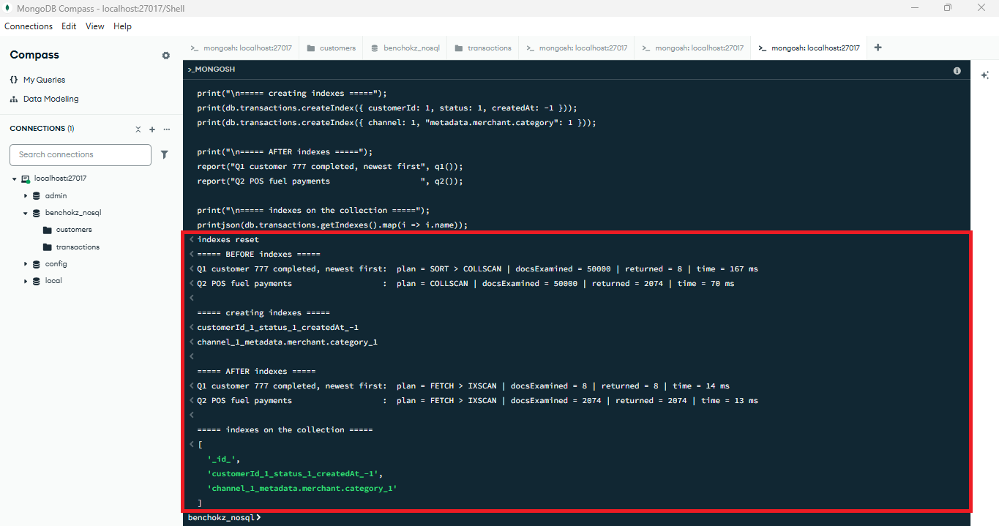
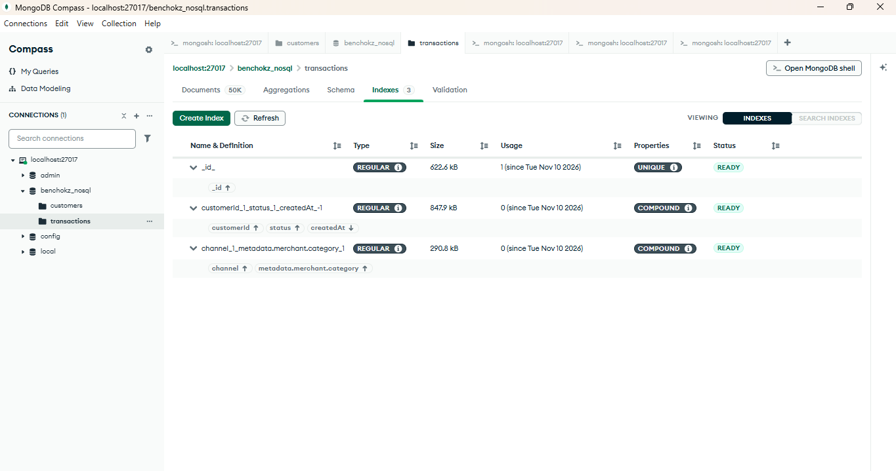

## Is MongoDB suitable for this case study?
**Where it fits well**
- **Transaction logs and activity records.** They are written in huge volumes, rarely changed, and each channel records different details. Documents handle that variety without empty columns or schema changes.
- **Customer profiles.** The customer and their accounts, preferences and contact details are read together, so one document means one fast read.
- **Growth.** MongoDB is designed to spread data across many servers (**sharding**), which is useful as the transaction log grows. I discuss this further in Portfolio 5.

**Where it fits less well**
- **Moving money.** A transfer must change two balances and add records together, or not at all. MongoDB can do multi-document transactions, but only on a replica set, and PostgreSQL's constraints (`CHECK balance >= 0`, foreign keys) and mature locking are a stronger base for a ledger.
- **Strict relationships.** MongoDB does not enforce foreign keys, so a transaction could point to a customer that does not exist unless the application checks.
- **Duplicated data.** If the same value (a branch name, for example) is stored in many documents, changing it means updating all of them.
- **Complex joins.** `$lookup` works, but joining many collections is more natural in SQL.

**My conclusion.** For Benchokz Bank I would use both: **PostgreSQL as the system of record** for accounts, balances and transfers, and **MongoDB for transaction/activity logs and customer profiles**. This is called polyglot persistence: using each database for what it does best.

**Limitations of this exercise.** The data is random fake data. I stored amounts as ordinary numbers, but a real bank should use MongoDB's `Decimal128` type to avoid rounding errors with money.

## Screenshots
All screenshots are in `screenshots/`:

- `01_load_output.png`, `01_load_output_b.png`: data loaded (counts and sample documents)
- `01_customers_document.png`, `01_transactions_document.png`: documents in Compass
- `02_q1` to `02_q7`: query results
- `03_a1` to `03_a5`: aggregation results
- `04_explain_before_after.png`, `04_indexes_tab.png`: index evidence

## What I learned
- A document database stores related data together, which makes some reads simple and fast, but leaves rules and consistency to the application.
- The structure of the data should follow how it is read: embed what is read together, and separate what grows without limit.
- NoSQL is not a replacement for SQL. Each is better for different jobs in the same system.

## Reflection
In SQL I had to split data across tables and join it back, but in MongoDB I could keep a customer's accounts inside one document and read them in one go. At first it was hard to decide what to embed and what to keep separate, and writing aggregation pipelines felt different from writing SQL. I was surprised that a new channel like USSD could be added without changing any schema, and by how much faster the indexed queries were.

**AI use:** Claude (an AI assistant by Anthropic) helped me design the MongoDB model, generate the scripts and draft this README, and helped me understand documents, aggregation pipelines and indexes. I installed MongoDB, ran every script myself, took the screenshots, and checked that the results match what I describe.
