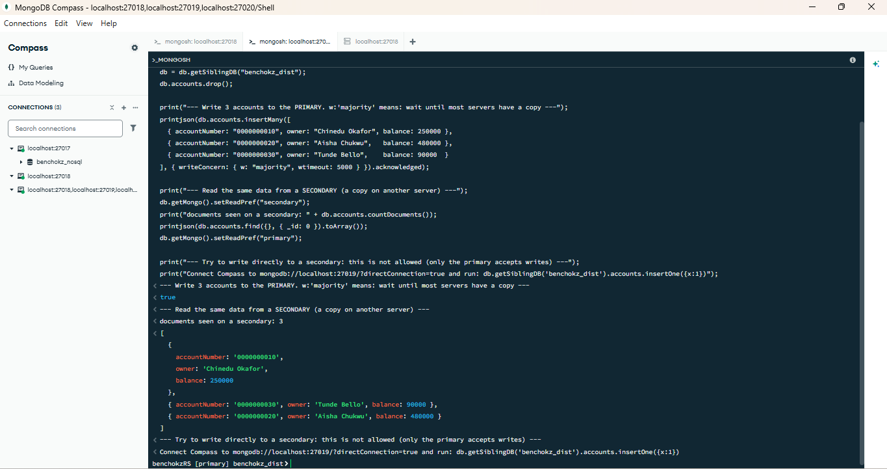
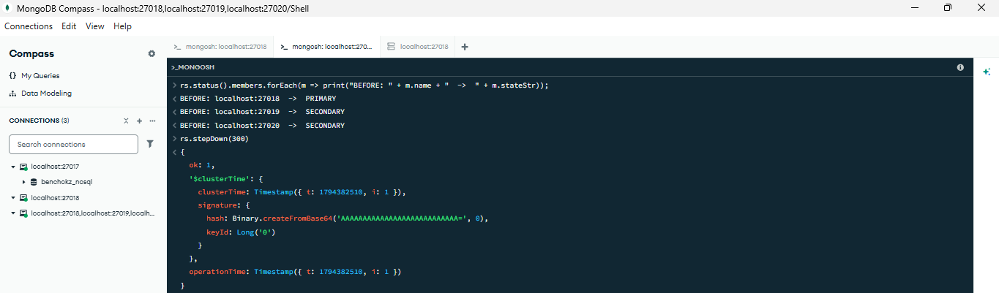
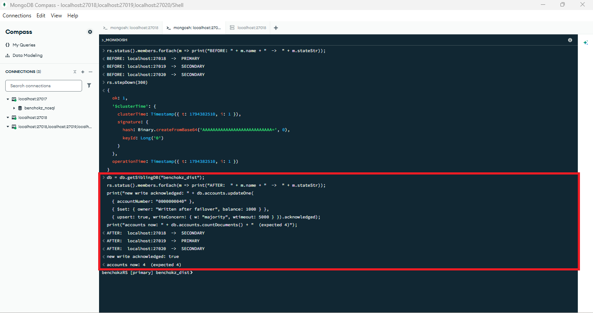
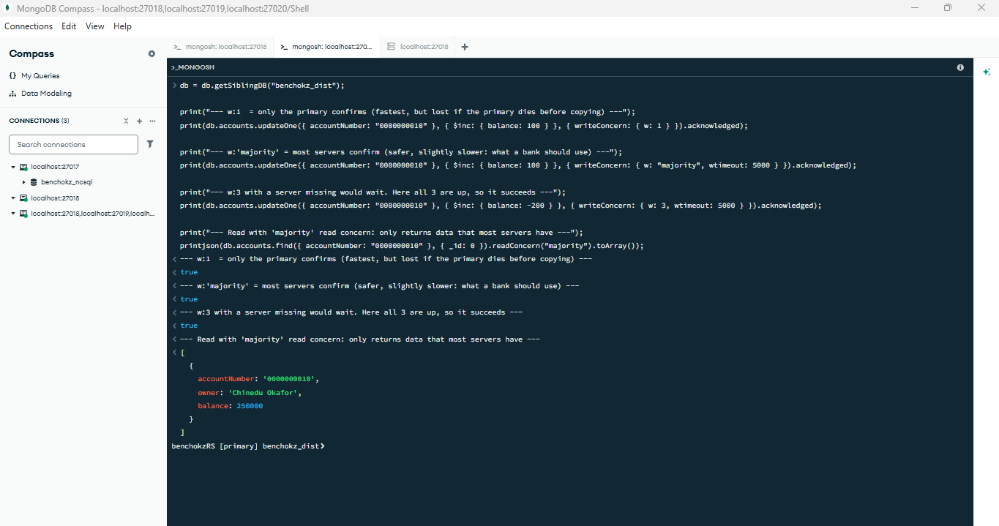

# Portfolio 5: Distributed and Cloud Database Exercise

**Evidence provided:** Distributed/cloud database discussion and setup based on the same case study, including replication, sharding, availability, consistency, and deployment evidence.

**Case study:** Benchokz Bank Limited (a simulated bank). In Portfolio 4 I said MongoDB could be used for transaction logs and customer profiles and that it can grow across many servers. Here I set up a small **replica set** to show replication, availability and consistency, and I discuss sharding and cloud deployment.

## In one minute
- A bank cannot afford to lose data or go offline when one server fails. A **distributed database** keeps copies of the data on several servers.
- I built a **replica set of 3 MongoDB servers** on my laptop (ports 27018, 27019, 27020). One is the **primary** (accepts writes) and two are **secondaries** (keep copies).
- I wrote data once, read it back from a secondary, then made the primary step down. A secondary took over automatically and the data was still there and still writable.
- I also compare **write concerns** (how many servers must confirm a write) and discuss **sharding** and **cloud deployment** for the bank.

## Key ideas (in plain words)
| Idea | Meaning | In Benchokz Bank |
|---|---|---|
| **Replication** | Keeping the same data on several servers | Every transaction log entry exists on 3 servers, so one failing does not lose data |
| **Availability** | The system keeps working when a server fails | If the primary stops, a secondary is elected and customers can still transact |
| **Consistency** | Everyone sees the same, correct data | `w: "majority"` makes sure most servers have a write before it counts as saved |
| **Sharding** | Splitting data across servers so no single server holds it all | Needed when the transaction log becomes too big for one machine |
| **Cloud deployment** | Running the database on a provider's servers | Managed services create and repair replica sets for you |

## Files in this folder
| File | What it does |
|---|---|
| `01_start_replica_set.ps1` | Starts 3 MongoDB servers on ports 27018 to 27020 (PowerShell) |
| `02_init_replica_set.js` | Joins the 3 servers into one replica set called `benchokzRS` |
| `03_check_status.js` | Shows which server is primary and which are secondaries |
| `04_replication_demo.js` | Writes data once and reads it from a secondary |
| `05_failover_before.js` | Shows the roles before the primary stops |
| `06_failover_after.js` | Shows the new primary, and a write after failover |
| `07_consistency_demo.js` | Compares write concerns `w:1`, `w:"majority"` and `w:3` |
| `08_stop_replica_set.ps1` | Stops only these 3 servers (my normal server on 27017 is not touched) |
| `screenshots/` | My evidence for each step |

## How I ran it
1. Ran `01_start_replica_set.ps1` in PowerShell to start the 3 servers.
2. In MongoDB Compass I connected to `mongodb://localhost:27018/?directConnection=true` and pasted `02_init_replica_set.js` into the shell, then ran `03_check_status.js` after about 10 seconds.
3. I then connected Compass with the replica-set address `mongodb://localhost:27018,localhost:27019,localhost:27020/?replicaSet=benchokzRS` and ran `04` to `07` in order. In the failover step I typed `rs.stepDown(300)` on its own line between `05` and `06`.
4. Ran `08_stop_replica_set.ps1` when I finished.

## What the demo shows
When I created the replica set, `localhost:27018` became the PRIMARY and `27019` and `27020` became SECONDARY. I wrote 3 accounts once (with `w: "majority"`) and could read all 3 from a secondary, which shows the data was copied. Then I made the primary step down with `rs.stepDown(300)`. About 10 seconds later `localhost:27019` had been elected the new PRIMARY, the 3 accounts were still there, and a new write was accepted (the count went to 4). So the set kept working with no data lost. Finally I ran writes with `w: 1`, `w: "majority"` and `w: 3`, and a read with `readConcern("majority")`; all succeeded because all three servers were up.

### Screenshots

## Replication and availability
In my replica set all writes go to the primary, which records them in a log (the oplog). The secondaries copy that log, so they hold the same data. The servers check on each other every couple of seconds. If the primary stops, the others hold an **election** and one of them becomes the new primary, usually in a few seconds. The application driver finds the new primary by itself.

With 3 servers the set can lose **1** server and still work (it needs a majority, 2 of 3, to elect a primary). With 5 servers it could lose 2. This is why replica sets use an odd number of members.

## Consistency: the trade-off
The **CAP theorem** says that when the network between servers breaks, a distributed system must choose between **consistency** (everyone sees the same data) and **availability** (always answer). MongoDB by default favours consistency: if a primary cannot reach a majority, it steps down and stops accepting writes, rather than risk two servers disagreeing about a balance.

How safe a write is depends on the **write concern**:
| Write concern | Meaning | Use for |
|---|---|---|
| `w: 1` | Only the primary confirms | Low-value data such as logs where speed matters more |
| `w: "majority"` | Most servers confirm | Anything important, including balances and transfers |
| `w: 3` | All three confirm | Rare; it waits if any server is down |

A **read concern** of `"majority"` makes sure a read returns only data that most servers already have. Reading from a **secondary** can return slightly old data (replication lag), so for a customer's live balance I would read from the primary.

## Sharding: how the transaction log could scale
Replication copies the **same** data to more servers (for safety). **Sharding** splits **different** data across servers (for size and speed). If Benchokz Bank grows to billions of transactions, one replica set will not be enough. I did not run a sharded cluster (it needs several more servers and a router), but my design would be:
- Shard the `transactions` collection with a **hashed shard key on `customerId`**. A hashed key spreads customers evenly, and a customer's own transactions stay on one shard, so queries for one customer touch one shard.
- I would **not** use `createdAt` as the key. New transactions always have the newest date, so every write would go to the same shard (a "hot shard").
- `customers` is small and can stay unsharded, on a replica set.
- Each shard would itself be a replica set, so there is replication and sharding together.

## Cloud deployment
In practice I would not run these servers by hand. A managed service such as **MongoDB Atlas** (on AWS, Azure or Google Cloud) creates a replica set automatically, spreads its members across **different availability zones** (separate data centres), and handles backups, monitoring, upgrades and scaling. For a Nigerian bank the choices would be: use a region close to customers to keep delay low, keep customer data in a location that meets Nigerian data-protection rules (NDPR/NDPA) and Central Bank of Nigeria requirements, and encrypt data in transit and at rest. I did not deploy to the cloud in this portfolio, so this section is a discussion.

## Suitability for Benchokz Bank
- **Ledger (balances, transfers):** keep in PostgreSQL, which can also be replicated (primary with streaming replicas) and has strong constraints.
- **Transaction logs and profiles:** MongoDB replica set now; add sharding on `customerId` if volume demands it.
- This matches the polyglot idea from Portfolio 4: each database used for what it does best, and each one replicated for availability.

## Limitations of this exercise
All 3 servers run on **one laptop**, so this shows how replication and failover work, but it gives **no real protection** against hardware failure: if the laptop is off, all three are off. The failover was triggered with `rs.stepDown()` (a controlled step down), not by crashing a server. Sharding and cloud deployment are discussed, not built.

## What I learned
- Replication is about **safety and availability**; sharding is about **size and speed**. They solve different problems and are often used together.
- Distributed systems always trade consistency, availability and speed. For money, I would choose consistency (`w: "majority"`).
- An odd number of servers matters, because a majority decides who is primary.

## Reflection
Before this I thought a database was one server, so it was new to me that several servers can hold the same data and elect a new leader when one steps down. The hardest part was understanding why my first failover test did not show a new primary: the old one had a higher priority and took the role back after its 60 seconds, so I repeated it with 300 seconds. For a real bank I would run the servers in separate data centres in the cloud, not on one laptop, and use `w: "majority"` for anything involving money.

**AI use:** Claude (an AI assistant by Anthropic) helped me plan this portfolio, write the PowerShell and mongosh scripts, and draft this README and the explanations of replication, consistency, sharding and cloud deployment. I ran the replica set myself, took the screenshots, and checked that the results match what I describe. I had not been able to test the replica-set scripts before running them, so I checked every output on my own machine.
